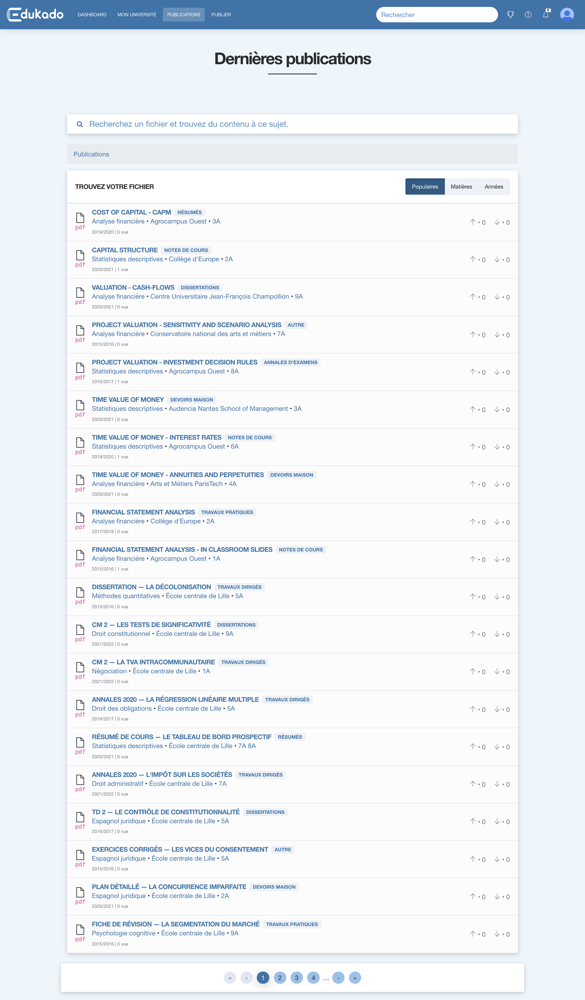
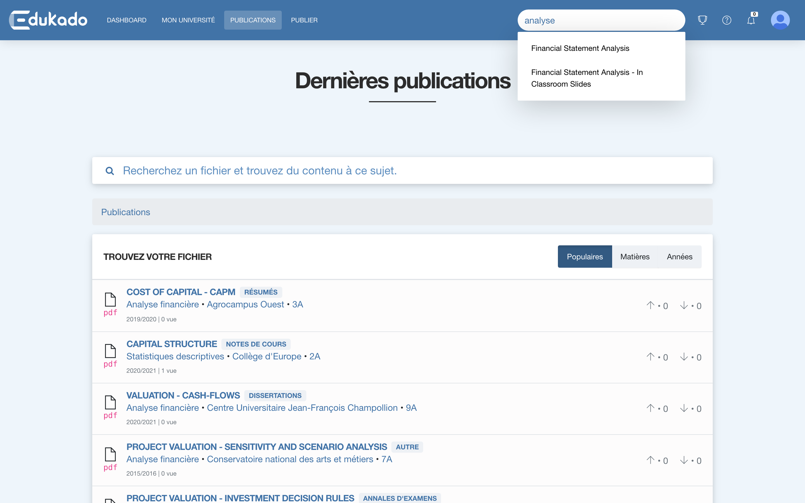
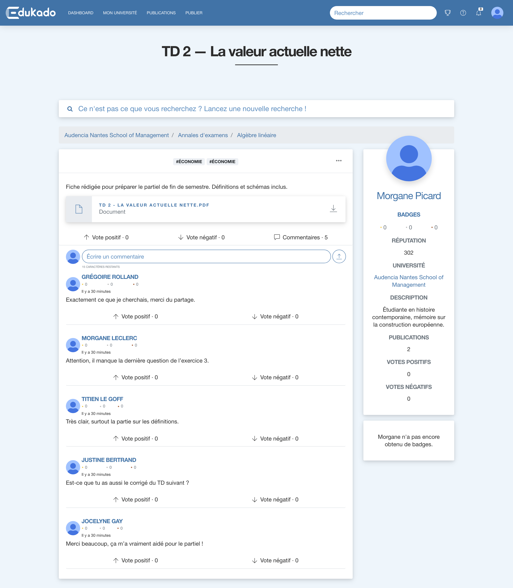
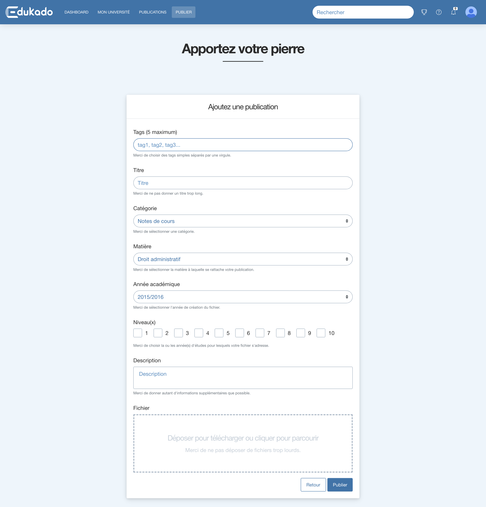
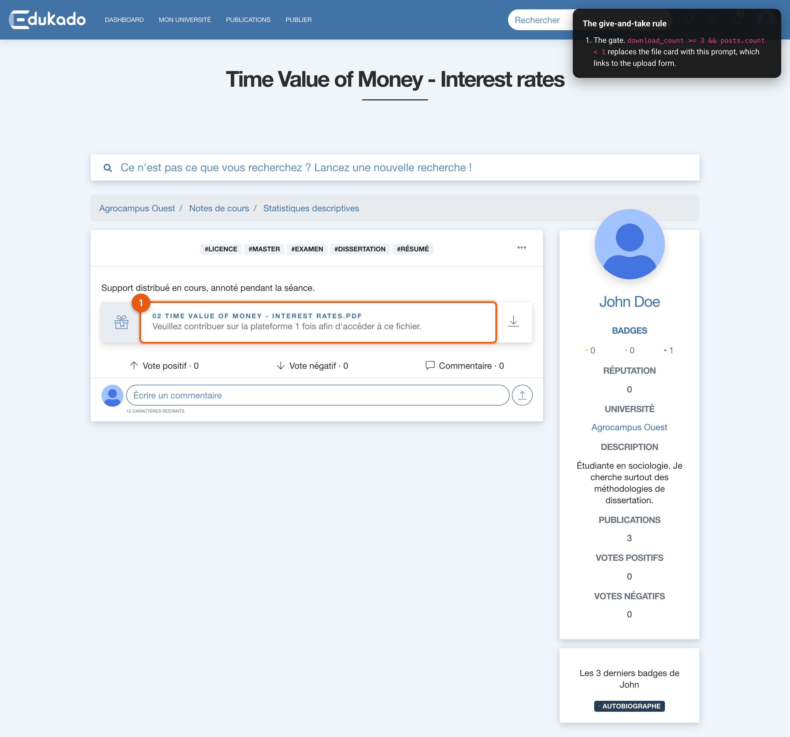
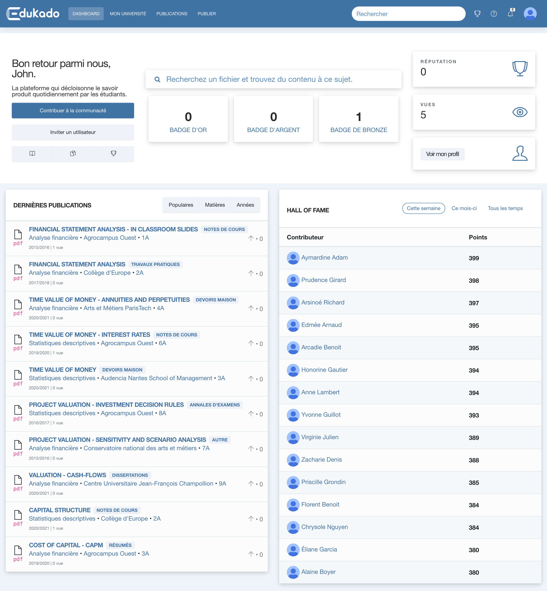
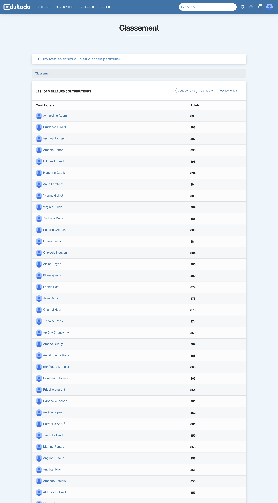
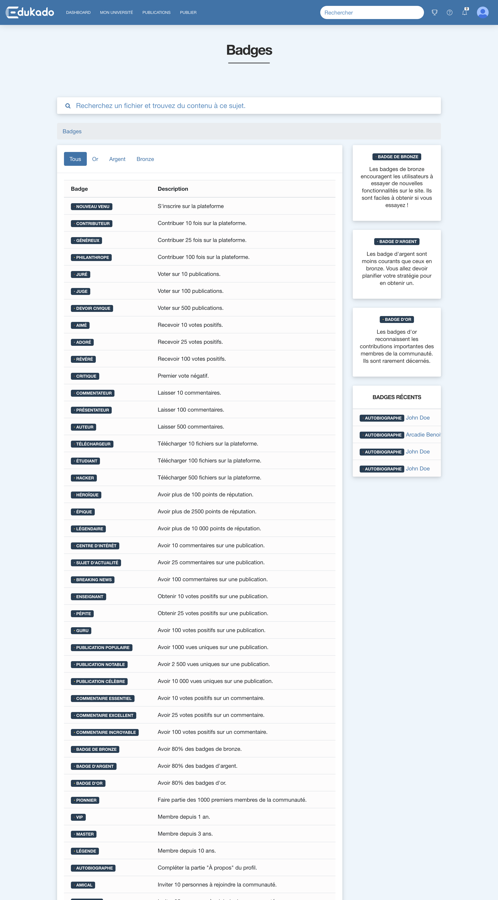
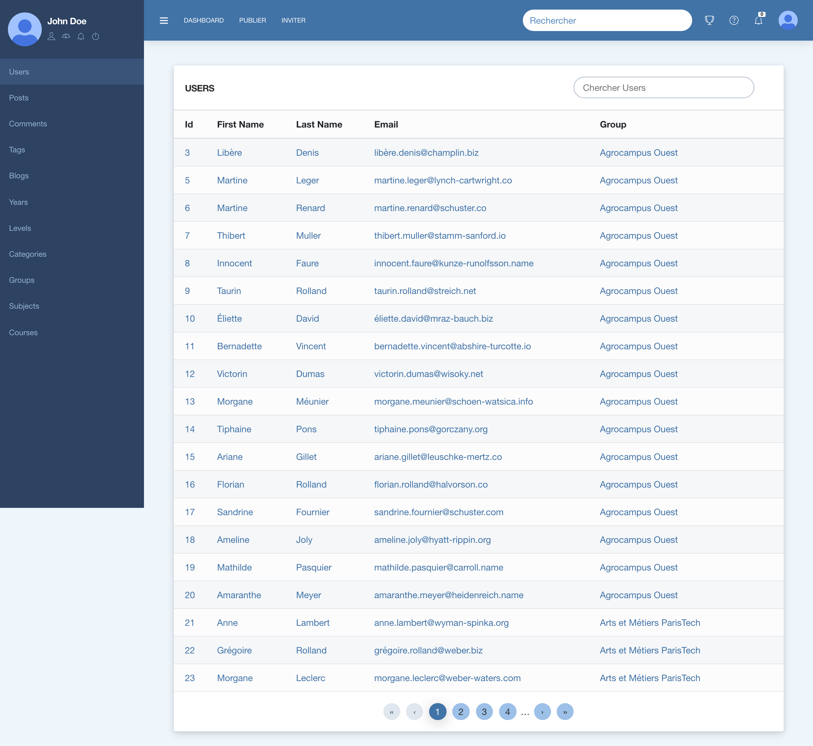
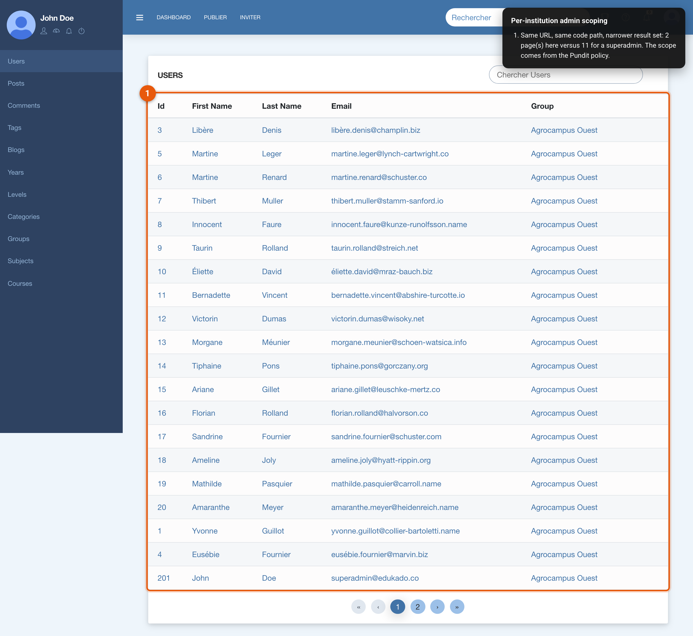

# Edukado

> **Décloisonnons le savoir** — *let's break down the silos of knowledge.*

A file-sharing platform where students trade course material with each other on a
**give-and-take** basis: download a few documents and the platform stops handing them
over until you have contributed something back.


---

## About this repository

I built Edukado on my own in **2019–2020** to learn Ruby and Ruby on Rails, by
picking a real problem and refusing to stop until it worked end to end. Almost
everything here — the reciprocity mechanic, the gamification, the permission model,
the admin back-office, the search layer — was learned from documentation, source
code and a great deal of trial and error.

**This code is a time capsule and is deliberately left untouched.** It was written
before AI coding assistants existed, and I keep it as an honest record of what I
could build by myself at the time. The only file added since is this README. If you
are reading it to judge how I write software, judge the commits — not this page.

That also means the warts are real and stay: this document has a
[candid section](#engineering-notes--what-has-aged) on what has aged badly and what
was already broken, because pretending otherwise would defeat the point of keeping it.

---

## The idea

Students accumulate lecture notes, past exam papers, summaries and problem sets, and
almost all of it dies on a hard drive after the exam. Sharing platforms that already
existed had the classic free-rider problem: a small minority uploads, everybody else
takes.

Edukado's answer is a **reciprocity gate** enforced at the moment of download:

| You have downloaded | …and uploaded | Result |
| --- | --- | --- |
| 0–2 files | anything | Download freely |
| 3 or more | nothing | Blocked until you upload **1** document |
| 5 or more | fewer than 3 | Blocked until you have uploaded **3** documents |

Hit the gate and the download button is replaced, in place, by a prompt pointing at
the upload form:

> *Veuillez contribuer sur la plateforme 1 fois afin d'accéder à ce fichier.*

Signed-out visitors get a different card inviting them to register. The rule lives in
[`app/views/active_storage/_file.html.erb`](app/views/active_storage/_file.html.erb),
and every download is counted by
[`DownloadsController`](app/controllers/downloads_controller.rb), which increments
`users.download_count` before redirecting to the Active Storage blob — so the file is
never linked directly.

Around that core sits a reputation economy meant to make contributing feel worth it:
points, 43 badges, and leaderboards.

**The app's interface and seed content are in French** (`default_locale = :fr`); the
codebase, comments and this README are in English.

---

## Features

### Contributions and files
- Upload any document type (PDF, images, text, audio, video) via **Active Storage**,
  with a drag-and-drop **Dropzone** field driven by a Stimulus controller.
- Every post is classified along six axes: institution, course, subject, academic
  year, study level and category — plus up to **5 free-form tags**, enforced by a
  custom model validation.
- File cards adapt their icon and label to the content type.
- Slugged URLs everywhere via **friendly_id** (`/posts/financial-statement-analysis`).

### Discovery and search
- Full-text search over posts and users through **Elasticsearch** (searchkick), with
  a custom `search_data` payload that flattens author name, institution, course,
  category, tags *and* comment bodies into the indexed document.
- **Typeahead autocomplete** on post titles (`word_start` matching, misspelling
  tolerance) served by a dedicated JSON endpoint.
- Browse by institution, course, subject, level, year, category or tag.
- Per-post view tracking with **impressionist**, counted unique-per-IP where it
  matters (the "popular document" badges).

### Reciprocity and reputation
- The download gate described above.
- **Points**: +10 for confirming an account, +50 for publishing a document
  ([`point_rules.rb`](app/models/merit/point_rules.rb)).
- **43 badges** across 16 bronze, 13 silver and 14 gold, declared as rules rather
  than hard-coded checks ([`badge_rules.rb`](app/models/merit/badge_rules.rb)) —
  awarded for contributing, voting, commenting, downloading, being an early member,
  inviting friends, filling in your profile, and even for *collecting 80% of the
  badges of a given tier*.
- **Leaderboards** at `/rankings` — top 100 contributors this week, this month and
  all time — backed by a hand-written SQL aggregation over Merit's score tables
  ([`config/initializers/score.rb`](config/initializers/score.rb)).

### Social layer
- Up/down voting on posts and comments (**acts_as_votable**), with counter caches on
  `posts` and a rule preventing you from voting on your own post.
- Comments — created, edited, deleted and voted on **without a page reload** —
  Turbolinks plus `.js.erb` responses, the pre-Hotwire way.
- In-app notifications when someone likes your post, with a "mark all as read" action.
- Email invitations (**devise_invitable**) with badges for inviting 10 / 25 / 100 people.
- A blog with cover images, and a FAQ section that never got finished (its index
  raises — see the [notes](#engineering-notes--what-has-aged)).

### Accounts and permissions
- **Devise** with eight modules: database authentication, registration, recovery,
  remember-me, validation, confirmation, tracking and invitations.
- Three roles — see [Roles](#roles) — authorised through **Pundit** policy objects.
- An **Administrate** back-office at `/admin` with 24 dashboards, a curated sidebar,
  and record scoping so that supervisors only ever see their own institution.

---

## Roles

Roles are three booleans on `users` (`superadmin_role`, `supervisor_role`,
`user_role`), enforced in two places: the Pundit policies in
[`app/policies/`](app/policies/) and
[`Admin::ApplicationController#authenticate_admin`](app/controllers/admin/application_controller.rb).

| Capability | Student (`user_role`) | Supervisor | Superadmin |
| --- | :---: | :---: | :---: |
| Browse, search, download (subject to the gate) | ✅ | ✅ | ✅ |
| Upload, comment, vote | ✅ | ✅ | ✅ |
| Own dashboard, badges, profile | ✅ | ✅ | ✅ |
| Edit / delete **own** posts | ✅ | ✅ | ✅ |
| Edit / delete posts **of their institution** | ❌ | ✅ | ✅ |
| Access `/admin` | ❌ *(302)* | ✅ | ✅ |
| See **all** institutions in `/admin` | ❌ | ❌ *(scoped)* | ✅ |

The shared predicate is `superadmin_or_supervisor_or_owner?` in
[`ApplicationPolicy`](app/policies/application_policy.rb); the institution scoping
lives in each policy's `Scope#resolve_admin`.

---

## Showcase

Running this yourself takes about half an hour (Ruby 2.6.4, Elasticsearch 7, a seed pass —
see [Running it locally](#running-it-locally)). These are captures of the real thing so you
do not have to.

The interface is in French. The data is generated demo content in a local database. Every
image below is a retina-resolution capture of a live page, not a mockup.

**→ [Full annotated gallery — 59 screens](docs/screenshots/GALLERY.md)**

### The student experience

**Landing page (signed out)** — Public entry point built from the theme's reusable partials, leading with the platform's premise: pooled coursework in exchange for your own.


**Document feed** — The heart of the platform: every shared document, filterable by institution, course, category, study level and academic year, with vote counts and comment counts inline.



**Search autocomplete** — Typeahead suggestions served by a dedicated `posts#autocomplete` endpoint querying Elasticsearch through searchkick, which indexes titles with `word_start` matching.



**Document detail** — A shared document: description, tags, course and level metadata, upvote and downvote controls, the attached file, and the comment thread beneath.



**Upload a document** — The contribution form: a Stimulus-driven Dropzone for the file, plus the taxonomy that makes it findable — institution, course, category, level and year.



### The give-and-take rule

**Contribution required** — After three downloads with no upload, the same partial swaps the download card for a contribution prompt. The rule is enforced in the view, and the download counter is incremented server-side by `DownloadsController`.



### Reputation: points, badges, leaderboards

**Student dashboard** — The signed-in student's own view: accumulated points, badges earned, and the documents they have contributed.



**Leaderboards** — Weekly, monthly and all-time rankings, computed by hand-written SQL over merit's score tables in `config/initializers/score.rb`.



**Badge catalogue** — All 43 badges, created at boot from declarative rules in `config/initializers/merit.rb` across bronze, silver and gold tiers.



### Back office and permissions

**Admin — users** — The Administrate back office. A superadmin sees every account across all ten institutions.



**One institution (supervisor)** — The identical route for a supervisor returns only their own institution's members. Administrate's `Punditize` prefers the policy's `resolve_admin` scope over `resolve`, so the narrowing happens in the Pundit policy rather than the controller.



### Responsive

**Document feed (mobile)** — The feed at 390 px. The 2020 theme was responsive throughout — no separate mobile templates.


**→ [Full annotated gallery — 59 screens](docs/screenshots/GALLERY.md)**, including the
complete Administrate back office, the discovery taxonomy, the authentication flows and the
known rough edges.

Both this section and the gallery are generated from the capture scripts in
[`docs/screenshots/tooling/`](docs/screenshots/tooling/), which also document how to reproduce the whole set.

---

## Architecture

A conventional, server-rendered Rails 6 monolith — chosen deliberately: the whole
point was to learn the framework's grain rather than fight it.

```
app/
├── controllers/
│   ├── admin/            # 24 Administrate controllers (Punditized)
│   ├── users/            # Devise overrides: registrations, sessions, invitations…
│   ├── downloads_controller.rb   # the metering choke point for every download
│   └── posts_controller.rb       # CRUD + votes + Elasticsearch autocomplete
├── dashboards/           # Administrate field definitions, one per model
├── policies/             # Pundit: 11 resource policies + a shared base
├── models/
│   ├── merit/            # point_rules · badge_rules · rank_rules (declarative)
│   ├── post.rb           # searchkick search_data, tag limit, vote counters
│   └── user.rb           # 8 Devise modules, merit, slugs, avatar
├── services/
│   └── admin_navigation.rb       # hides join tables from the admin sidebar
├── fields/               # custom Administrate field (Action Text rich area)
├── javascript/
│   ├── controllers/      # Stimulus: dropzone, form
│   ├── kiso_themes/      # bundled Bootstrap 4 theme
│   └── packs/            # webpacker entry points
└── views/
    ├── active_storage/   # _file.html.erb ← the reciprocity gate
    ├── content_blocks/   # 68 reusable theme partials
    └── **/*.js.erb       # Turbolinks-era partial updates
```

**Request flow.** `ApplicationController` mixes in Pundit and renders a French
"not authorised" flash on `Pundit::NotAuthorizedError`. Controllers pick one of
several layouts (`scaffold`, `statics`, `sidenav`) — `UsersController` even switches
layout per action. Records are looked up by slug (`Post.friendly.find`) and then
authorised.

**Search.** `Post` and `User` are `searchkick` models. In production the client is
pointed at a hosted cluster via `BONSAI_URL`
([`config/initializers/elasticsearch.rb`](config/initializers/elasticsearch.rb)); in
development searchkick's default `localhost:9200` is used.

**Gamification.** Merit observes controller actions rather than model callbacks, so
badge and point rules read as a list of conditions tied to `posts#create`,
`posts#like`, `users#dashboard` and so on.

### Data model

30 tables. The heart of it:

```
Group (institution) ──< Course >── Subject
      │                    │
      └──< User ──< Post >─┘
                │    ├──< Comment ──< Vote
                │    ├──< Vote
                │    ├──< LevelsPost >── Level
                │    ├──> Year, Category
                │    └──< PostsTag >── Tag
                ├──< Notification
                ├──< TagsUser >── Tag
                ├──< Blog ──< BlogsTag >── Tag
                └──> Sash ──< Score ──< ScorePoint   (Merit)
                        └──< BadgesSash
```

---

## Tech stack

| Concern | Choice | Why |
| --- | --- | --- |
| Framework | Rails 6.0 | Learning goal; batteries included |
| Database | PostgreSQL | Needed for the leaderboard's SQL aggregation |
| Auth | Devise + devise_invitable | Confirmation, recovery and invitations for free |
| Authorisation | Pundit | Plain-Ruby policy objects over a DSL |
| Admin | Administrate + Punditize | Back-office without hand-writing CRUD |
| Search | Elasticsearch via searchkick | Started with `pg_search`, outgrew it (see notes) |
| Gamification | merit | Declarative rules instead of scattered callbacks |
| Files | Active Storage (Disk in dev, S3 in prod) | Rails-native, swappable backend |
| Voting | acts_as_votable | Polymorphic votes with counter caches |
| Slugs | friendly_id | Readable, shareable URLs |
| Pagination | kaminari | |
| Views | ERB + Turbolinks + `.js.erb` | Pre-Hotwire partial updates |
| JS | Webpacker 4 + Stimulus + jQuery/Bootstrap 4 | Rails 6 default at the time |
| Analytics | impressionist | Unique-per-IP view counts |
| Mail | letter_opener (dev) · SendGrid (prod) | |
| Seeds | faker + CSV fixtures | 200+ realistic students, real French universities |
| Hosting | Heroku + Bonsai (Elasticsearch) + S3 | `render.yaml` is a later, unfinished migration — see [Deployment](#deployment) |

---

## Running it locally

The stack is from 2020 and **Ruby 2.6.4 no longer builds on a current macOS** —
Homebrew has dropped `openssl@1.1`, and Ruby 2.6 cannot compile its OpenSSL extension
against OpenSSL 3. Containers are therefore the realistic path, and the one below is
the one I actually verified: it boots, seeds and serves the app.

### Prerequisites
- Docker (Desktop or Engine) with Compose v2
- ~4 GB of free RAM (Elasticsearch alone takes 512 MB of heap)
- On Apple Silicon the app container runs `linux/amd64` under emulation. It works;
  page loads are just slow.

### 1. Clone

```bash
git clone https://github.com/gabrielguerin/edukado-web.git
cd edukado-web
```

### 2. Create `docker-compose.yml`

Save this at the repository root. It is **not** part of the repo — the 2020 code
predates it — so you are adding it to your own working copy only.

```yaml
name: edukado

services:
  # Postgres owns the shared network namespace: this code hard-codes `localhost`
  # for both Postgres (config/database.yml) and Elasticsearch (searchkick's
  # default), so every service joins one namespace and one `localhost`.
  db:
    image: postgres:12
    environment:
      POSTGRES_USER: edukado
      POSTGRES_PASSWORD: edukado
    ports:
      - "3000:3000"   # Rails
      - "5432:5432"   # Postgres
      - "9200:9200"   # Elasticsearch
    volumes:
      - pgdata:/var/lib/postgresql/data

  search:
    image: docker.elastic.co/elasticsearch/elasticsearch:7.13.4
    network_mode: "service:db"
    environment:
      discovery.type: single-node
      xpack.security.enabled: "false"
      ES_JAVA_OPTS: "-Xms512m -Xmx512m"
    depends_on: [db]

  web:
    platform: linux/amd64
    build:
      context: .
      dockerfile_inline: |
        FROM ruby:2.6.4
        # package.json pins Node 12.16.2; NodeSource no longer serves 12.x,
        # so take the tarball straight from nodejs.org.
        RUN curl -fsSL https://nodejs.org/dist/v12.16.2/node-v12.16.2-linux-x64.tar.xz -o /tmp/node.tar.xz \
         && tar -xJf /tmp/node.tar.xz -C /usr/local --strip-components=1 \
         && rm /tmp/node.tar.xz \
         && npm install -g yarn@1.22.19
        RUN gem install bundler -v 2.2.17
        WORKDIR /app
    network_mode: "service:db"
    volumes:
      - .:/app
      - bundle:/usr/local/bundle
      - node_modules:/app/node_modules
    environment:
      RAILS_ENV: development
      # config/database.yml gives host/user/password only to the `development:`
      # block, so `rails db:create` — which also builds the test database —
      # would fall back to a Unix socket and fail. libpq env vars cover the gap.
      PGHOST: localhost
      PGUSER: edukado
      PGPASSWORD: edukado
    command: sleep infinity
    depends_on: [db, search]

volumes:
  pgdata:
  bundle:
  node_modules:
```

### 3. Start the services

```bash
docker compose up -d --build
```

Wait for Elasticsearch to report green (about 30 seconds):

```bash
docker compose exec web curl -s localhost:9200/_cluster/health
```

### 4. Install dependencies

`yarn install` **must** come before any `rails` command: this app sets
`check_yarn_integrity: true` for development, so Webpacker aborts every Rails
invocation while `node_modules` is out of date.

```bash
docker compose exec web bundle install
docker compose exec web yarn install --frozen-lockfile
```

Installing 132 gems, several with native extensions, takes a while under emulation.
If DNS inside the container flakes mid-download (`Gem::RemoteFetcher::UnknownHostError`),
just run it again — `bundle install` resumes from what it already fetched.

### 5. Create development credentials

`config/master.key` is not in the repository (it never should be), so the original
`config/credentials.yml.enc` cannot be decrypted — and `config/database.yml` *and*
`db/seeds.rb` both read from it. Rails 6 lets you supply per-environment credentials
that take precedence in development without touching the existing file:

```bash
cat > /tmp/edukado-credentials.yml <<'YAML'
development:
  postgres_username: edukado
  postgres_password: edukado
  superadmin_email: superadmin@edukado.co
  superadmin_password: password
  supervisor_email: supervisor@edukado.co
  supervisor_password: password
  user_email: user@edukado.co
  user_password: password
YAML

docker compose cp /tmp/edukado-credentials.yml web:/tmp/creds.yml
docker compose exec web bash -lc \
  'EDITOR="cp /tmp/creds.yml" bundle exec rails credentials:edit --environment development'
```

The `EDITOR="cp …"` indirection is deliberate: the container has no text editor, and
`credentials:edit` just runs `$EDITOR <tempfile>` and re-encrypts whatever comes back.

> Rails appends `/config/credentials/development.key` to `.gitignore` for you. If you
> want the tree pristine again afterwards, `git checkout .gitignore`.

### 6. Set up the database

```bash
docker compose exec web bundle exec rails db:create db:schema:load
docker compose exec web bundle exec rails db:seed
```

Seeding takes a couple of minutes and builds a genuinely populated platform:
**203 users, 110 documents, 500 comments, 50 blog posts, 10 French universities,
40 courses, 30 subjects, 8 categories, 10 study levels, 7 academic years** and
160 file attachments.

### 7. Build the Elasticsearch mappings

**Do not skip this.** Seeding indexes records one by one, which makes Elasticsearch
auto-create the index without searchkick's analyzers; searching then fails with
`Searchkick::InvalidQueryError (Bad mapping - run Post.reindex)`.

```bash
docker compose exec web bundle exec rails runner 'Post.reindex; User.reindex'
```

### 8. Compile the JavaScript packs

```bash
docker compose exec web ./bin/webpack
```

### 9. Serve

```bash
docker compose exec web bundle exec rails s -b 0.0.0.0
```

Open **http://localhost:3000**. The first request takes a few seconds while the app
boots under emulation.

Tear everything down with `docker compose down -v`.

---

## Test accounts

All seeded accounts are pre-confirmed, and the password for every one of them is
`password` (as set in step 5).

| Email | Role | Try it for |
| --- | --- | --- |
| `superadmin@edukado.co` | Superadmin | `/admin` across **all** institutions |
| `supervisor@edukado.co` | Supervisor | `/admin` scoped to one institution |
| `user@edukado.co` | Student | The ordinary student experience |

Each of the three starts with a handful of uploads — the ten documents imported from
`lib/seeds/posts/posts_test.csv` are shared between them, and the seed also assigns
generated documents at random, so the exact count per account varies from one seed run to
the next.

Plus **200 generated French students**, same password. Their emails are random per
seed run, so pick one — this also finds a student with **no uploads**, which the
three accounts above do not have:

```bash
docker compose exec web bundle exec rails runner \
  'puts User.left_joins(:posts).where(posts: { id: nil }).first.email'
```

---

## A five-minute tour

1. **Sign in as `superadmin@edukado.co`** → you land on your dashboard: points,
   badges, your documents. Visit `/admin` for the Administrate back-office, then
   `/admin/users` and `/admin/posts`.
2. **Sign in as `supervisor@edukado.co`** → `/admin` still works, but the record
   scoping limits you to your own institution.
3. **Sign in as `user@edukado.co`** → `/admin` now redirects you away with a French
   flash message. Browse `/posts`, search for `Financial`, watch the typeahead fire,
   open a document, vote and comment (both update without a reload).
4. **See the give-and-take gate.** You need an account with **no uploads**, so grab
   one with the one-liner above and sign in as them. Download three files, then
   reopen a document — the download card is gone, replaced by the invitation to
   contribute. Use a document that has **no comments** (see the caveat in the notes
   below):

   ```bash
   docker compose exec web bundle exec rails runner \
     'puts Post.left_joins(:comments).where(comments: { id: nil }).limit(3).pluck(:slug)'
   ```
5. **Upload a document** via `/posts/new` to clear the gate — and collect +50 points
   and possibly a badge.
6. **Check `/rankings` and `/badges`** to see the reputation economy, and
   `/notifications` for the in-app feed.

Emails (confirmations, invitations, password resets) are not sent in development —
**letter_opener** writes them to `tmp/letter_opener/` and opens them in a browser
instead.

---

## Useful commands

```bash
# Rails console / logs
docker compose exec web bundle exec rails console
docker compose exec web tail -f log/development.log

# Live-reloading JS instead of a one-off build
docker compose exec web ./bin/webpack-dev-server

# Re-seed from scratch (destructive; stop the server first so db:drop can run)
docker compose exec web bundle exec rails db:drop db:create db:schema:load db:seed
docker compose exec web bundle exec rails runner 'Post.reindex; User.reindex'

# Routes and psql
docker compose exec web bundle exec rails routes
docker compose exec db psql -U edukado -d edukado_web_development
```

---

## Tests

There is a `test/` directory with 133 tests, and **I should be straight about it: it
is generated scaffolding that was never filled in.** Model and policy tests are empty
stubs; controller and system tests are the generator's defaults with blank params.

Worse, the whole suite errors before it runs a single assertion, because
`test/fixtures/notifications.yml` still references a `subscribed_user` column that the
schema replaced with `notified_by_id`, and `fixtures :all` loads it for every test:

```
133 runs, 0 assertions, 0 failures, 133 errors, 0 skips
```

Automated testing is the clearest gap in this project, and the honest lesson from it.
I verified the behaviour described in this README by driving the running application
instead.

---

## Engineering notes — what has aged

Kept as found; documented rather than fixed.

**The toolchain is end-of-life.** Ruby 2.6, Rails 6.0, Node 12 and Elasticsearch 7 are
all past support, and several of the pinned gems have since had security advisories.
Do not deploy this. Ruby 2.6.4 also cannot be built on a current macOS without
`openssl@1.1`, which Homebrew has removed.

**The reciprocity gate crashes on documents that have comments.** In
`_file.html.erb`, the normal branch guards with `if object.file.attached?`, but the two
gated branches render `_file-card` unconditionally — and that partial calls
`object.file.filename`. The same partial is rendered for every comment, and comments
almost never carry a file, so a gated user opening a commented document gets
`ActionView::Template::Error (filename delegated to attachment, but attachment is nil)`.
It is invisible in normal use because you only reach those branches once you are
gated. The gate itself works correctly; it is the fallback card that is missing a
guard.

**`/faq` returns a 500.** The view is untouched generator scaffolding — complete with
"Listing faqs" and a hard-coded theme sidebar — and it calls `new_faq_path` and
`edit_faq_path`, while `routes.rb` exposes FAQs as `only: [:index]`. The helper does
not exist, so the page cannot render. The seeds create no FAQs either.

**`config/database.yml` is incomplete.** Host, username and password are only set
under `development:`; the `test:` block inherits none of them, so `rails db:create`
fails on the test database unless you supply `PGHOST`/`PGUSER`/`PGPASSWORD`, as the
compose file above does.

**Seeding leaves Elasticsearch with the wrong mapping**, which is why step 7 exists.
The per-record indexing during seeds beats searchkick's own index creation.

**The seed CSVs are coupled to random data — and it does fail.** `db/seeds.rb` finishes
by importing documents from `lib/seeds/posts/posts_test.csv`, matching courses *by name*
against courses generated with `Faker::Book.title` under the `:fr` locale. The CSV
hard-codes names like *"La Promise du voyeur"*; when the random draw does not happen to
produce them, `Course.find_by` returns nil and seeding aborts with
`ActiveRecord::RecordInvalid: Course doit exister`. It succeeded on one run and failed on
the next. It matters more than it looks: those ten rows are the uploads belonging to the
three test accounts, so a failed import leaves them with no contributions at all.
[`docs/screenshots/tooling/finish-csv-import.rb`](docs/screenshots/tooling/finish-csv-import.rb)
completes it idempotently without touching the seed file.

**Four admin sections raise, because their policies were never written.** `routes.rb`
exposes Administrate dashboards for the gem-owned tables — `admin/merit/scores`,
`admin/merit/badges_sashes`, `admin/merit/activity_logs` and
`admin/acts_as_votable/votes` — but no `Merit::ScorePolicy`, `Merit::BadgesSashPolicy`,
`Merit::ActivityLogPolicy` or `ActsAsVotable::VotePolicy` exists. Every admin controller
mixes in `Administrate::Punditize`, so all four fail with `Pundit::NotDefinedError`.

**The back office is read-only in practice.** `ApplicationPolicy#update?` returns
`false` and `edit?` delegates to it, and no resource policy overrides either — so
`/admin/<resource>/:id/edit` is refused for **every** role, superadmin included, even
though Administrate renders the links. The eleven index and show pages work; nothing can
be changed through them.

**`/levels/:id` always raises.** `LevelsController#show` is an empty method, but
`app/views/levels/show.html.erb` still passes `object: @posts` to the kaminari partial.
`@posts` is never assigned, so pagination calls `total_pages` on `nil`. The index at
`/levels` is fine; every level detail page is not.

**Secrets management is half-finished.** `config/database.yml` reads the development
Postgres credentials from the encrypted store, which couples "can I run this at all"
to a key that is deliberately not distributable. Environment variables would have been
the right call.

**Search was migrated mid-project and the old path was left behind.** `pg_search`
started as the search layer; migration `20200508133050_drop_pg_search_documents`
removed its table when Elasticsearch took over, but the gem is still in the `Gemfile`
and a (hidden) Administrate dashboard for its documents survives.

**Business rules live in views.** The reciprocity thresholds — the single most
important rule in the product — are hard-coded in an ERB partial rather than in a
policy or model, duplicated across two branches. That is the change I would make
first.

**Other rough edges:** commented-out ranking badge rules and a `-50` points-per-download
rule left in place as dead code; `posts#create` uses `save!` inside a
`respond_to` block, so validation failures raise instead of re-rendering the form;
`PostsController#destroy` redirects to `:back`, removed in Rails 5; some French
validation messages use a malformed interpolation (`%<count>` without `s`).

---

## Deployment

The app ran on **Heroku**, as two apps — `edukado-web-staging` and
`edukado-web-production`. That is recorded in the code rather than in any deployment
manifest: [`config/environments/production.rb`](config/environments/production.rb) hard-codes
the mailer host as `edukado-web-production.herokuapp.com`, and the original history carries
a commit about "deployment to Heroku".

Production services, each read by the application itself rather than declared in a
platform config:

| Variable | Service | Read in |
| --- | --- | --- |
| `BONSAI_URL` | Bonsai hosted Elasticsearch — a Heroku add-on | [`config/initializers/elasticsearch.rb`](config/initializers/elasticsearch.rb) |
| `AWS_ACCESS_KEY_ID` · `AWS_SECRET_ACCESS_KEY` · `AWS_BUCKET` | S3 for Active Storage, region hard-coded to `eu-west-3` | [`config/storage.yml`](config/storage.yml) |
| `DOMAIN` | Mailer host, falling back to `localhost:3000` | [`app/controllers/application_controller.rb`](app/controllers/application_controller.rb) |
| `RAILS_MASTER_KEY` | Credentials decryption (`require_master_key = true`) | Rails |

Transactional email went through **SendGrid**, configured in
[`config/environment.rb`](config/environment.rb).

### An abandoned migration to Render

[`render.yaml`](render.yaml) and [`bin/render-build.sh`](bin/render-build.sh) also sit in
the tree, and they are easy to mistake for the production setup. They are not:

- Neither file exists anywhere in the 861-commit original history. Both were added
  afterwards, in the single commit that re-rooted this branch.
- The manifest declares only `RAILS_MASTER_KEY` and `DATABASE_URL`. Nothing would have
  supplied Elasticsearch or S3, so search and file uploads could not have worked.
- The same commit **commented out** the SendGrid block in `config/environment.rb`, which is
  live in the original history.

Treat it as an unfinished attempt to redeploy the app years later, not as how it ran.

---

## Status

Archived. Not maintained, not accepting contributions, and not intended for
production use — it exists as a record of a self-taught project from 2019–2020.
